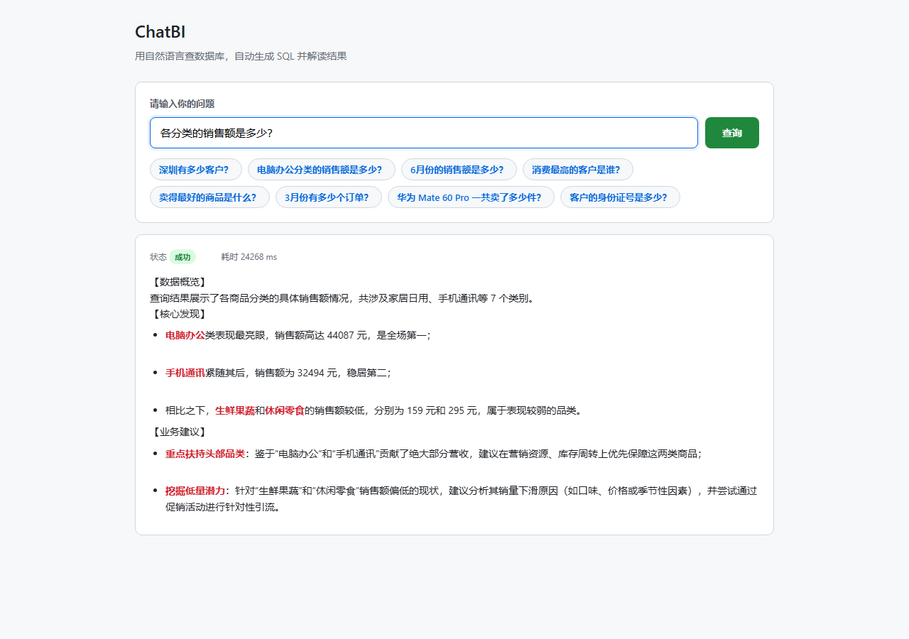
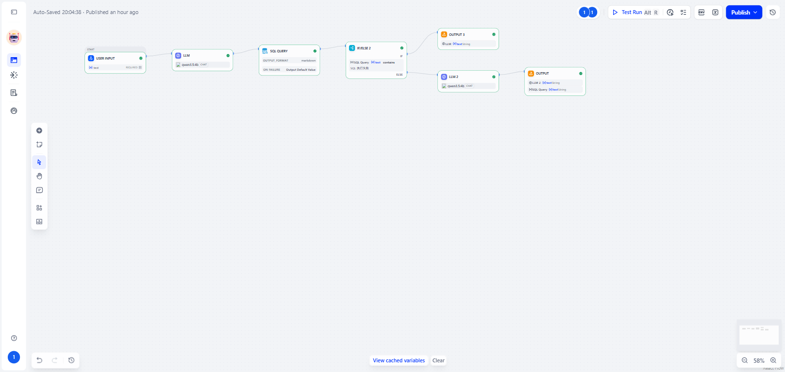

# ChatBI：用 Dify 搭的自然语言查数助手

把中文问题变成 SQL，执行后用人话解释结果。数据是我按电商业务造的一套 5 表 MySQL 库。

做了三个版本，核心变化是**模型换到云端后，Prompt 能大幅精简**。

## 三个版本

| | V1 | V2 | V3 ReAct |
|---|---|---|---|
| **SQL 生成模型** | qwen3.5:4b（本地） | **DeepSeek-V3（云端）** | DeepSeek-V3（云端） |
| **Prompt 长度** | **8900 字符** | **506 字符** | 1486 字符 |
| **表结构来源** | 内联在 Prompt 里 | **RAG 检索（top_k=4）** | RAG 检索（top_k=6 + Rerank） |
| 节点数 | 7 | 9 | 16 |
| 纠错回路 | 无 | 无 | 两条 |

### 演进逻辑

**V1 → V2 是「换模型 + 串 RAG」同时做的。**

V1 用本地 4B 模型，理解力不够，只能在 Prompt 里堆东西：

```
8900 字符 = 完整表结构（含每个字段的含义说明）+ 11 条业务规则 + 9 个查询示例
```

V2 换成 DeepSeek-V3 后，规则说清就够了，表结构也能交给 RAG 按需检索：

```
506 字符 = 4 条核心红线 + {{#context#}} 由 RAG 注入表结构
```

**这是这个项目里最关键的一个认知：Prompt 该多长，取决于模型有多强。**

### V2 → V3 是「加纠错能力」

V2 的死穴是**用户说法和数据库实际值对不上**：

| 用户问 | 数据库里实际是 |
|---|---|
| MacBook 卖了多少 | MacBook Air M3 |
| iPhone 卖了多少 | Apple iPhone 15 128G |
| 罗技鼠标卖了多少 | 罗技无线鼠标 |

SQL 用精确匹配查不到，返回空。V3 加了两条回路解决这个问题。

## 架构：混合推理

```
用户提问
   ↓
【RAG 检索】本地 bge-m3 → 返回相关表结构
   ↓
【生成 SQL】云端 DeepSeek-V3 ← 只收到表结构，不接触业务数据
   ↓
【执行 SQL】本地 MySQL
   ↓
【解读结果】本地 qwen3.5:4b ← 收到真实查询结果，数据不出内网
   ↓
用户
```

| 环节 | 模型 | 部署 | 输入 | 为什么这么放 |
|---|---|---|---|---|
| Schema 检索 | bge-m3 | 本地 | 用户问题 | 问题本身可能含业务信息 |
| **SQL 生成** | **DeepSeek-V3** | **云端 API** | **表结构** | 只有表名、字段名，不含真实数据 |
| SQL 执行 | MySQL | 本地 | SQL 语句 | 数据不出内网 |
| **结果解读** | **qwen3.5:4b** | **本地** | **查询结果** | 客户姓名、金额等敏感数据 |

**关键判断**：

> 「表结构」是数据库设计信息（有哪些字段、字段含义），「业务数据」是实际存储内容（张三消费了 61991 元）。前者可以给云端，后者不行。这个边界划清楚了，就能在保证隐私的前提下用更强的云端模型。

**需要说明的地方**：V3 的 Rerank 用的是云端 Qwen3-Reranker-8B，检索到的表结构片段会上云。严格讲只有真实业务数据不上云。

## 效果



### 有存档支撑的数字

| 测试集 | 样本 | 指标 | 数据来源 |
|---|---|---|---|
| 留出集 | 10 | **准确率 70%** | `results/holdout_test.json` |
| RAG 召回（V2） | 20 | **召回率 100%，MRR 0.6958** | `results/app1_recall_fixed.json` |
| ReAct 版（V3） | 18 | **准确率 94.4%，平均 14.6s** | `results/react_eval.json` |

**ReAct 版唯一的失败是环境故障**（沙箱 `operation not permitted`），不是逻辑错误。

### RAG 召回率要打个折看

知识库只有 7 个父段，top_k=6 几乎能捞全。**这个数字证明不了 RAG 方案优越，只能说明当前配置在当前数据量下够用。**

但父子分段的机制是有效的：

- 子段短（39~48 字符）→ 向量匹配精准
- 父段完整（1100~1900 字符）→ 模型能拿到整张表的定义
- MRR 0.6958 → 20 个问题里 9 个排第 1 位

### 一个说过头的数字

我早期跑过 14 个用例全通过，在文档里写「100% 准确率」。后来复查发现**其中 6 个和 Prompt 示例几乎一字不差**，是严重过拟合。重新设计 10 个未出现过的问法后，掉到 70%。

**70% 才是真实水平。**

## 工作流结构

**V1（7 节点）：**
```
用户输入 → LLM(qwen3.5, 8900字符Prompt) → SQL执行 → IF/ELSE → LLM2解读 → 输出
                                                      ↓
                                                  执行失败 → 错误提示
```

**V2（9 节点）** 加了两个节点：
```
用户输入 → RAG检索 → LLM(DeepSeek-V3, 506字符) → SQL执行 → Code状态机 → IF/ELSE → LLM2解读 → 输出
```

**V3 ReAct（16 节点）** 加了两条纠错回路：

```
                    ┌─ success ─→ LLM2 解读 → 输出
IF/ELSE 三态判断 ───┤
                    ├─ empty ──→ LLM3 实体探测 → LIKE 查库
                    │              ↓
                    │           找到实体？─→ LLM4 重写 SQL → 再执行 → 解读
                    │              ↓没找到
                    │           Output 2：友好提示
                    └─ error ──→ Output 3：友好提示
```



*上图是 V1 的画布（7 节点）。V3 的 16 节点画布在本地 Dify 里，需要登录才能查看。*

### 纠错回路的实际效果

| 问题 | 模糊问法 | V3 结果 |
|---|---|---|
| MacBook 卖了多少件 | 库里是 `MacBook Air M3` | ✅ 4 件 |
| iPhone 卖了多少件 | 库里是 `Apple iPhone 15 128G` | ✅ 1 件 |
| 罗技鼠标卖了多少件 | 库里是 `罗技无线鼠标` | ✅ 5 件 |
| 华为手机卖了多少件 | 库里是 `华为 Mate 60 Pro` | ✅ 2 件 |
| 林峰花了多少钱 | 库里是 `林峰`（精确） | ✅ 17697 元 |

**5 个模糊问法全部命中。** 这是 V3 相比 V2 最实际的价值。

### SQL 重写的设计意图

不做二次全量生成，而是把「原 SQL + 探测到的真实实体」一起给模型，让它只改实体部分。

**跳过 Schema 重新注入这一步**，降低二次生成引入新错误的概率。

（不能说成「100% 保留 JOIN 逻辑」——Prompt 只说了「只替换实体」，模型仍可能改动其他部分。）

## 踩过的坑

### 1. Prompt 被浏览器翻译搞坏了

有段时间工作流完全不能用，查出来 Prompt 变成了：

```sql
选择总和（oi.quantity）为total_sales
来自order_items oi
JOIN 命令 o on 的 oi.order_id = o.id
工会
精选
```

`SELECT` 变成「选择」，`FROM` 变成「来自」，`UNION` 变成「工会」。

**原因是浏览器的网页翻译把 Dify 编辑器里的代码也翻了。**

教训：**Prompt 一律在本地文件维护**，Dify 里只是部署。

### 2. 二级分类查询反复出错

错误 SQL：

```sql
-- 把二级分类当一级分类，去找它的子分类
WHERE p.category_id IN (
    SELECT id FROM categories WHERE parent_id = (SELECT id FROM categories WHERE name = '电脑办公')
)
-- 电脑办公没有子分类，返回空
```

正确写法：

```sql
-- 一级分类（数码电器）：递归子类
WHERE p.category_id IN (
    SELECT id FROM categories WHERE name = '数码电器'
    UNION
    SELECT c2.id FROM categories c2 JOIN categories c1 ON c2.parent_id = c1.id
    WHERE c1.name = '数码电器'
)

-- 二级分类（电脑办公）：等值匹配，禁止递归
WHERE p.category_id = (SELECT id FROM categories WHERE name = '电脑办公')
```

**这个问题在 V1 里修好了（8900 字符 Prompt 有地方写细节），V2 精简到 506 字符后规则被砍掉，又复发了。**

后来在 V2 的 Prompt 里加回一条「查二级分类直接等值匹配，查一级分类必须包含子类」才解决。

### 3. 销售额口径选错

问「6月销售额」返回 19114，正确答案 15284。

两个数都对，只是口径不同：

| 字段 | 数值 | 含义 |
|---|---|---|
| `SUM(oi.subtotal)` | 19114 | 商品原价小计（GMV） |
| `SUM(o.pay_amount)` | 15284 | 实际到账（扣整单优惠） |

差 3830 元，正好是 6 月的优惠总额。

**这个问题是我修前一个 bug 时引入的**——为了修分类销售额，加了「销售额按明细汇总」规则，结果时间维度也被套用了。

### 4. Code 节点判断逻辑有 bug（最隐蔽的一个）

V3 刚做完时，所有有数据的查询都被判成空，错误触发了纠错回路。

```python
# 旧代码：优先信 json 字段
if not has_data:                    # sql_json 永远是 [{"data": []}]
    return {"status": "empty"}      # 永远走这里
```

**插件 `junjiem/db_query` 在 markdown 输出模式下，`json` 字段永远是空数组**，真实数据只在 `text` 字段里。

结果：所有查询都判空 → 全部走纠错回路 → LLM4 把正确的表名改成了 `product_category`、`users` → SQL 报错。

**修复后**：平均耗时从 36.2s 降到 13.2s（不再走无用回路）。

**这个案例的价值**：

> 系统里任何一层判断出错，都会伪装成上一层的问题。表面看是「模型生成了错误表名」，查执行轨迹才发现第一次生成的 SQL 完全正确——是代码节点误判把它送进了纠错回路。

### 5. 直接改数据库把知识库搞坏了

为更新 RAG 文档，我直接操作数据库（删除分段 → 插入新内容 → 重建向量）。

**结果：RAG 检索返回空，持续了 11 分钟。**

连锁反应：

```
RAG 检索为空 → 模型没有表结构参考 → 编造表名 product_categories
→ SQL 报错 → 全部查询失败
```

**原因**：Dify 的知识库不只是「文档 + 向量」，还维护内部状态（分段 ID、index_node_id、关键词）。直接改数据库绕过了这套机制。

**正确做法**：在 Dify 界面里编辑文档。

### 6. 性能瓶颈不是模型慢

一次查询要 65 秒。

拆开看节点耗时：

| 节点 | 耗时 | 占比 |
|---|---|---|
| SQL 生成（云端 V3） | 4.4s | 15% |
| **结果解读（本地 qwen3.5）** | **20s+** | **80%** |
| RAG 检索 | 1.0s | 4% |

**根因**：两个 LLM 节点的 `num_ctx` 不一致——生成 SQL 的是 4096，解读的是 **14096**。

```
显卡 4GB，模型 3.49GB
num_ctx=14096 → KV cache 占几百 MB → 更多层落到 CPU
num_ctx=4096  → KV cache 缩小 → GPU 能装下更多层
```

**统一降到 4096 后：65.6s → 19.1s，提速 3.4 倍。**

**方法论**：性能问题先做分解测量，不要猜。

## 性能数据

> ⚠️ **测试环境**：笔记本（RTX 3050 Laptop GPU，4GB 显存），**电池供电，未插电源**，默认电源策略。
>
> 电池模式下 CPU/GPU 会被主动限功耗，所以这些耗时**比接电源时慢**。详见 [docs/测试环境说明.md](docs/测试环境说明.md)

节点耗时（20 次运行平均）：

| 节点 | 模型 | 部署 | 耗时 | 占比 |
|---|---|---|---|---|
| LLM（生成 SQL） | DeepSeek-V3 | 云端 | 4.4s | 15% |
| SQL Query | MySQL | 本地 | 0.06s | 0.2% |
| **LLM 2（解读）** | qwen3.5:4b | **本地** | **20s** | **80%** |
| Knowledge Retrieval | bge-m3 | 本地 | 1.0s | 4% |

**瓶颈在本地解读模型，这是混合架构的直接代价。**

云端 SQL 生成 4 秒就返回了。本地 qwen3.5:4b 生成 400 字符分析要 20 秒——显卡 4GB 装不下整个模型（3.49GB），只能混合推理。

**这个延迟是主动选的**：解读节点要处理真实业务数据，不能上云。

### 两轮优化（相对提升比绝对值更可信）

| 优化项 | 优化前 | 优化后 | 提升 |
|---|---|---|---|
| num_ctx 从 14096 降到 4096 | 65.6s | 19.1s | **3.4x** |
| 修 Code 节点误判（V3） | 36.2s | 13.2s | **2.7x** |

**这两组对比是在同一台机器、同样电池供电下测的**，只是改了配置，所以相对提升是可信的。绝对值换台机器会变。

## 项目结构

```
ChatBI-Dify/
├── README.md
├── docs/
│   ├── 三版演进.md                 三个版本的详细对比
│   └── 问题总结.md                 6 个真实问题的根因分析
├── prompts/
│   ├── llm1-sql-generator-v1.txt   V1 SQL生成（8919 字符，qwen3.5）
│   ├── llm1-sql-generator-v2.txt   V2 SQL生成（543 字符，DeepSeek-V3）
│   ├── llm1-sql-generator-v3.txt   V3 SQL生成（1523 字符）
│   ├── llm2-analyst-v1.txt         V1 结果解读（853 字符）
│   ├── llm2-analyst-v2.txt         V2 结果解读（853 字符）
│   ├── llm2-analyst-v3.txt         V3 结果解读（662 字符）
│   ├── llm3-entity-probe.txt       V3 实体探测（330 字符）
│   └── llm4-sql-rewriter.txt       V3 SQL重写（310 字符）
├── dify_workflow/
│   ├── chatbi_v1.json              V1（7 节点）
│   ├── chatbi_v2.json              V2（9 节点）
│   ├── chatbi_v3_react.json        V3（16 节点）
│   └── workflow_structure.md
├── rag/
│   └── 06_全局关联关系与业务红线.md
├── sql/
│   └── seed.sql                    5 张表 + 测试数据
├── src/
│   ├── call_dify_api.py
│   └── demo_server.py              演示页面（零依赖）
├── tests/
│   ├── holdout_test.py             留出集测试（10 题）
│   ├── eval_app1_recall.py         召回率测试（20 题）
│   ├── eval_react.py               ReAct 版评测（18 题）
│   ├── eval_50.py                  50 样本评测
│   ├── batch_test.py               14 用例批量测试
│   ├── diagnose.py                 单问题诊断（打印生成的 SQL）
│   ├── perf_breakdown.py           节点耗时分析
│   └── token_analysis.py           token 用量分析
├── results/                        测试结果存档
└── assets/                         截图
```

## 复现

**1. 准备数据库**

```bash
mysql -u root -p -e "CREATE DATABASE cd CHARACTER SET utf8mb4;"
mysql -u root -p cd < sql/seed.sql
```

**2. 导入工作流**

Dify → 工作流 → 导入 DSL → 选 `dify_workflow/` 下的 json

三个版本都可以单独导入。

**3. 配置数据库连接**

SQL Query 节点需要填（Dify 跑在 Docker 里的话用宿主机 IP）：

| 参数 | 值 |
|---|---|
| db_host | 宿主机 IP |
| db_port | 3306 |
| db_name | cd |
| db_username | root |
| db_password | 你的密码 |
| db_properties | `useUnicode=true&characterEncoding=utf8&serverTimezone=Asia/Shanghai&useSSL=false&allowPublicKeyRetrieval=true` |

⚠️ **`characterEncoding=utf8` 必须加**，否则中文全显示成问号。

**4. 更新 Prompt**

把 `prompts/` 下对应版本的内容粘贴到 LLM 节点，然后**点发布**。

（改了不发布，API 调用走的还是旧版本。这个也踩过。）

**5. 跑测试**

```powershell
$env:DIFY_APP_KEY="app-xxxx"
$env:DB_PASSWORD="你的密码"
python tests/eval_react.py
```

## 演示页面

零依赖，只用 Python 标准库：

```powershell
cd src
$env:DIFY_APP_KEY="app-xxxx"
python demo_server.py
```

看到这段说明成功：

```
================================================================
ChatBI 演示页面
================================================================
  地址: http://127.0.0.1:8600
```

打开 **http://127.0.0.1:8600**

**关掉命令行窗口服务就停了**，要重新启动。

## 不足

**数据量小。** 5 张表几十行。真实业务可能几百张表。

**测试集自己造的。** 所有问题都是我设计的，有主观性。

**没有真实用户。** 没有并发测试。

**没有权限控制。** 连接用的是 root 账号。

**多轮对话没做。** 现在只支持单轮问答。

**Rerank 走云端。** 与「数据不出内网」的叙事有矛盾。

**`customers.total_spent` 字段数据有缺陷。** 造数据时写死的，和订单表汇总不一致，导致相关查询结果偏差。

## 下一步

1. 加多轮记忆 —— 改成 chatflow，支持「那广州呢」这类追问
2. 图表可视化 —— 查询结果自动选图表类型
3. 修 `total_spent` 数据缺陷
4. 接入更多表，验证 RAG 在 20+ 表规模下的真实价值

## 这个项目说明了什么

**知道 Prompt 长度取决于模型能力** —— V1 用本地 4B 要 8900 字符，V2 换云端 V3 只要 506 字符

**知道怎么验证效果** —— 先做 14 个测试发现过拟合，重做留出集得到 70%

**能从故障里定位根因** —— Code 节点误判伪装成模型生成错 SQL，RAG 检索空追溯到直接改数据库

**会区分「标准答案错」和「模型错」** —— 测试失败时先怀疑自己的答案

---

代码 MIT。
